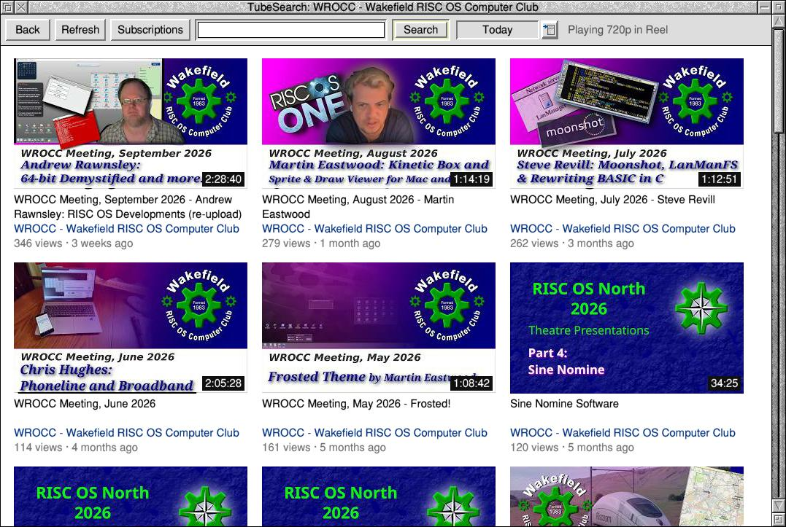
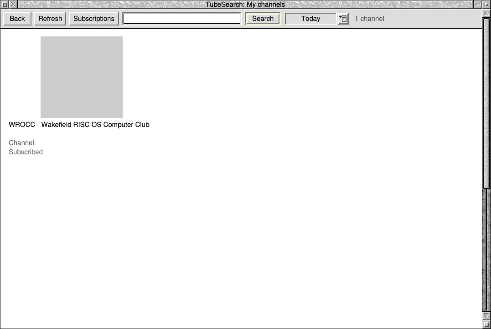

# TubeSearch: YouTube on RISC OS

A desktop program for RISC OS 5 that searches YouTube, shows the results
with their pictures, and plays the video you click in **Reel**
(riscos-ffmpeg), which decodes H.264 on the Raspberry Pi's hardware
through ReelHWAccel. No web browser is involved: TubeSearch talks to YouTube's
own API (Innertube) over HTTPS through the AcornSSL module.

Not made by or connected with YouTube or Google.





## Download

From [Releases](https://github.com/adyoull/riscos-tubesearch/releases):
`TubeSearch-x.y.z.zip`. Unzip it on RISC OS (SparkFS or InfoZip keep the
filetypes).

## Using it

Unzip `TubeSearch-x.y.z.zip`, open the directory with `!Reel` in it once (so
the `*Reel` command exists), and run `!TubeSearch`. Click its icon bar icon,
type a search and press Return.

| | |
|---|---|
| Select on a video | plays it in Reel |
| Adjust on a video | the videos related to it |
| Select on a channel's name | that channel's videos |
| More (last tile) | the next part of the list |
| Back | the page before |
| Subscriptions | the newest videos of the channels you follow (Adjust: the channels) |
| Refresh (or F5) | the page on screen fetched again (a live stream that has started, new videos) |
| Menu | Play, Related, Channel, Save video, Copy (embed code, no-cookie embed code, link, short link), Subscribe, Back, Refresh, Quality (360p–1080p), Frame rate (30/60), Sound (my language / original / a language; languages you also understand) |
| a pasted YouTube address | plays it, and shows what's related |
| Menu on the icon bar icon | Info, Search, Subscriptions, My channels, Quality, Frame rate, Sound, Quit |
| Uploaded (beside Search) | Any time, Today, This week, This month, This year |

**Save video** (on a video's menu) saves it as an MP4: drag the save box's
file icon to a Filer window. TubeSearch fetches the picture and sound
(HLS pieces, or DASH in 4 MB ranges) and `ffmpeg` joins them without
re-encoding, in a TaskWindow; so saving needs an ffmpeg command: !FFmpeg
(riscos-ffmpeg) or any RISC OS port from FFmpeg 2.x on. Only save what you
have the right to keep.

**Subscriptions** are kept on the machine (`Choices:TubeSearch.Subscriptions`),
with no YouTube account. Drop Google Takeout's `subscriptions.csv`, or a
NewPipe or FreeTube export, on the window to bring yours in. The videos come
from each channel's feed (`/feeds/videos.xml?channel_id=`), or its page if
that fails.

**Language**: YouTube's language and country come from the RISC OS
territory (Germany: `de`, `DE`), or, on the UK territory, from the keyboard
(French: `fr`, `FR`; RISC OS 5 has no France territory module). Sound > My
language chooses one; Config's `language` and `region` also set them. Titles are shown in the desktop's alphabet (Latin-1 to Latin-10,
Greek, Cyrillic, Hebrew, Arabic, Welsh or UTF-8), and search words are sent
as UTF-8. Sound > My language plays the dub in your language, Sound > Language
another's; Sound > I also understand (Config's `languages`, `en de`) ticks
others you understand, whose originals play undubbed.

The menus' choices are saved in `Choices:TubeSearch.Choices` and kept for
the next run.

**A web proxy** (for connections YouTube keeps calling a bot, such as
mobile broadband): `*Set http_proxy http://[user:password@]host:port/`.
TubeSearch and Reel both use it (Reel through FFmpeg), and must agree,
because YouTube's video addresses only work from the connection that asked
for them; so TubeSearch reads `http_proxy` and `no_proxy` exactly as FFmpeg
5.1 does (`http://` and a port required, Basic login, FFmpeg's `no_proxy`
matching), and again before each search or video. The proxy must accept
`CONNECT`.

Needs RISC OS 5.28 or later (AcornSSL), SharedUnixLibrary 1.16+ and
ARMEABISupport (PackMan), Reel 0.1.27+, and a 16 or 32 bit-per-pixel
desktop.

## How it works

- **Lists** (search, related, a channel's videos, continuations): the
  WEB client's `youtubei/v1/search`, `next` and `browse`, read by a
  walker that collects `videoRenderer`, `lockupViewModel` and
  `channelRenderer` wherever they are, so small layout changes don't
  break it.
- **Streams**: the VISIONOS client's `player`, which (October 2026) gives
  plain addresses: no JavaScript deciphering and no proof-of-origin
  token. By default (`stream_format = hls`) TubeSearch fetches the answer's
  HLS master playlist and gives Reel the H.264 variant no taller than the
  chosen quality (30 fps preferred) and its default sound group, as two
  media playlists; YouTube throttles or refuses long DASH requests part way
  (they need yt-dlp's 10 MB range chunks), while HLS is many short ones.
  `stream_format = dash` gives the DASH pair: H.264 (`avc1`) and the default
  AAC track.
- **The TV fallback**: when YouTube won't serve that client, TubeSearch asks
  as YouTube's TV app (TVHTML5, yt-dlp's default client), whose addresses
  carry a scrambled signature and an "n" challenge. It fetches the player's
  JavaScript (`/iframe_api` for its ID; its `signatureTimestamp` goes into
  the request) and has yt-dlp's own solver scripts
  ([yt-dlp/ejs](https://github.com/yt-dlp/ejs)) answer them in
  [QuickJS](https://bellard.org/quickjs/), built into `tscli` without its
  std and os modules. The desktop app runs that as a helper task
  (`tscli -wimp solve`, its own memory, polling the Wimp) and keeps the
  prepared player, so only the first video after a YouTube player update
  is slow.
- **Keeping the solver current**: `ejs.json` here names the solver version
  yt-dlp pins, with its SHA3-512 hashes; a weekly GitHub Action
  (`.github/workflows/update-ejs.yml`) updates it after checking the new
  scripts answer known challenges for a recorded player. TubeSearch reads it
  once a day, downloads that version from yt-dlp/ejs's releases, checks the
  hashes, and goes back to its bundled copy if a new one fails.
- **Playing**: TubeSearch writes a yt-dlp `-j` style JSON file (title, the two
  addresses, the User-Agent) to `<Wimp$ScrapDir>` and runs `*Reel` on it.
- **Network**: `src/http.c` is a non-blocking HTTP/1.1 client (keep-alive,
  chunked, one connection per host), driven from null events so the
  desktop never waits. `src/transport_riscos.c` hands a UnixLib socket to
  AcornSSL the way riscos-ffmpeg's `tls_acornssl.c` does; through a proxy
  (`src/proxy.c`), the socket first carries a `CONNECT` (as FFmpeg's
  `httpproxy:` does) and AcornSSL takes it over once the proxy says 200.
- **Upload-date filter**: the search's `params`, base64 of the protobuf
  `{2: {1: date}}` (today 2, week 3, month 4, year 5), as Invidious builds
  it; continuations carry it on.
- **Pictures**: `i.ytimg.com` thumbnails drawn once into 32bpp sprites by
  SpriteExtend (`JPEG_PlotScaled` with output switched to the sprite).

YouTube changes its clients every few months. Every client string can be
overridden in `!TubeSearch.Config` or `Choices:TubeSearch.Config` without a rebuild.

`tscli` (in `!TubeSearch`, and buildable on Linux) runs the same code from a
command line: `tscli search …`, `related ID`, `channel UC…`,
`play ID [lines] [file]`, with `-dump DIR` to keep YouTube's answers.

## Building and testing

With [riscos-crossdev](https://github.com/adyoull/riscos-crossdev) (a tag,
toolchain installed with `make prebuilt`):

```sh
make RCD_DIR=path/to/riscos-crossdev          # out/TubeSearch-VERSION.zip, after the crossdev checks
make test RCD_DIR=path/to/riscos-crossdev     # all the Linux tests
```

The tests use real YouTube answers recorded by NewPipe's test suite
(`tests/fetch-fixtures.sh` fetches them; they aren't kept here):

- `test_yt`: the JSON reader and the list/stream parsers on those answers
  (and a TV-client answer made from them);
- `test_jsolve`: yt-dlp's solver in QuickJS on a real recorded player
  (854a788e): the same answers node gives;
- `test_sha3`: SHA3-512 against Python's hashlib and yt-dlp's pinned hashes;
- `test_http`: the HTTP client against a fake connection that delivers
  bytes in random small pieces (chunked, keep-alive, stale connections,
  cancelling, timeouts);
- `test_ui`: the whole desktop front end against crossdev's fake RISC OS
  (a fake Wimp, SpriteExtend and network): search, pictures, play,
  related, channel, More, Back, menus, resizing, errors;
- `e2e.sh`: `tscli` over real TLS against a local stand-in for YouTube
  and GitHub: lists, playing, the TV fallback with QuickJS, the cache,
  updates through GitHub's redirect, a bad hash, broken scripts;
- the portable code again as ARM code under QEMU with RISC OS's alignment
  trap, including the whole solve (QuickJS and the solver).

Tested by hand on a Raspberry Pi 4 (RISC OS 5, Reel 0.1.27+).

### On GitHub, and with Docker

Every push and pull request is built and tested on GitHub
(`.github/workflows/riscos-build.yml`) in riscos-crossdev's container image,
the release named in `.riscos-deps`; the zip is kept on the run's page. The
same build on any machine with Docker:

```sh
docker run --rm -v "$PWD":/src ghcr.io/adyoull/riscos-crossdev:1.8.2 make check all
```

Once a day `riscos-deps-update.yml` looks for a newer riscos-crossdev
release; when there is one it builds and tests with it and opens a pull
request saying whether that passed. Nothing is merged or released by
itself: merge, try it on a Pi, then release. Release candidates are
GitHub pre-releases. (riscos-crossdev's `docs/CI.md` explains the chain.)
`update-ejs.yml` keeps `ejs.json` at the solver version yt-dlp pins.

## Licence and support

MIT (`COPYING`). Bundled: QuickJS (MIT, `third_party/quickjs`, with a
two-line RISC OS patch in `PATCHES`) and yt-dlp's solver scripts
(Unlicense, `ejs/`; they contain meriyah, ISC, and astring, MIT, with their
licence texts). `!TubeSearch.Licences` has them all. Support is as-is, at the maintainer's own pace; report
problems in GitHub Issues (say which release, and what `tscli` prints
for the same search or video). Written with Claude as a coding assistant;
Andrew Youll directs the work and tests on a Raspberry Pi 4.
